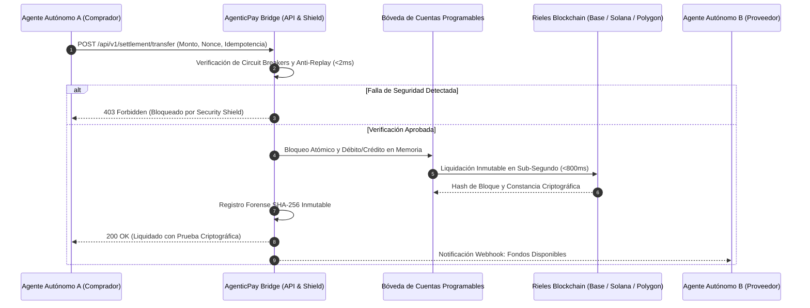

# 🏛️ MEMORANDO TÉCNICO INSTITUCIONAL
## Arquitectura de Sistema, Modelo de Amenazas y Protocolo de Liquidación para Comercio Agéntico Autónomo (A2A) e Infraestructura Blockchain para Fintechs

**Referencia Documental:** `TC-MEMO-2026-A2A-01-ES`  
**Clasificación:** Especificación Abierta de Arquitectura Institucional  
**Autoridad Emisora:** ThinkConnect IA Engineering Core  
**Arquitecto Principal & Senior SRE:** Carlos Ferro (`carlos@thinkconnect.com.ar`)  
**Fecha de Emisión:** 31 de Octubre de 2026  

---

### 1. Resumen Ejecutivo

La infraestructura financiera tradicional—construida sobre tarjetas de crédito (Visa/Mastercard), redes corresponsales (SWIFT) y cámaras de compensación bancaria (ACH)—fue concebida para un comercio humano y diferido. Estas redes exhiben fallas estructurales insalvables ante la emergente economía de agentes autónomos de Inteligencia Artificial:
1. **Latencia Inviable:** Tiempos de acreditación de 24 a 72 horas hábiles, paralizados durante fines de semana y feriados.
2. **Estructura de Costos Prohibitiva:** Comisiones fijas y variables que hacen inviables los micro-pagos de centavos de dólar entre servicios.
3. **Barreras Humanas Interactivas:** Autenticación en dos pasos (3D Secure, SMS OTP, biométricos) que bloquean la operativa autónoma de agentes sin intervención de personas.

**AgenticPay Bridge** resuelve este descalce entregando a fintechs, billeteras digitales y neobancos un middleware ultra-liviano (<60MB de RAM) y de liquidación en sub-segundo (<800ms) que opera sobre rieles de blockchain de alto rendimiento (USDC/USDT sobre Base, Solana y Polygon). Conecta los cores bancarios tradicionales mediante APIs REST con cuentas digitales programables, respaldadas por un blindaje de seguridad determinístico.

---

### 2. Arquitectura de Liquidación en Blockchain



#### Características Clave del Protocolo:
* **Moneda de Liquidación:** Stablecoins institucionales (USDC / USDT), respaldadas 1:1 por Letras del Tesoro de EE.UU. y depósitos bancarios de reserva.
* **Velocidad de Ejecución:** Menor a 800 milisegundos de punto a punto, con enrutamiento interno de API en menos de 15 milisegundos.
* **Aislamiento Atómico:** Semántica de bloqueo transaccional que erradica colisiones, doble gasto y saldos inconsistentes en operaciones concurrentes.

---

### 3. Especificación de la Bóveda de Cuentas (Wallet Vault)

Las fintechs que integran el Bridge disponen de una capa de emisión programática de sub-cuentas:
* **Cero Exposición de Llaves Privadas:** Las llaves criptográficas y capacidades de firma están desacopladas de la API expuesta, previniendo fugas por inyección de código.
* **Particiones Multi-Moneda:** Cada billetera gestiona balances aislados e independientes para USDC, USDT y saldo de referencia en moneda local.
* **Nomenclatura Determinística:** Identificadores con prefijo hexadecimal (`wlt_xxxxxxxxxxxx`) diseñados para indexación veloz y trazabilidad sin colisiones.

---

### 4. Matriz Defensiva de Amenazas: Lecciones de "Octubre Negro"

Tras la ola de incidentes de ciberseguridad, ataques a APIs y drenajes de liquidez observados en despliegues de agentes autónomos durante 2026, AgenticPay Bridge implementa una defensa matemática innegociable en cuatro niveles:

| Nivel Defensivo | Mecanismo | Implementación Concreta | Consecuencia ante Infracción |
| :--- | :--- | :--- | :--- |
| **Nivel 1: Techo de Liquidez** | Límite Máximo por Operación | Umbral rígido por cada transferencia individual (Default: $5.000 USD). | Rechazo inmediato con código HTTP 403. |
| **Nivel 2: Disyuntor de Velocidad** | Monitor de Ventana Móvil de 60 Segundos | Rastreo dinámico de volumen y frecuencia transaccional por minuto. | Disparo del Circuit Breaker global; congelamiento preventivo; alerta a sysadmin. |
| **Nivel 3: Blindaje Anti-Replay** | Nonces con Épocas Monotónicas | Cada transferencia exige un nonce numérico estrictamente ascendente por agente. | Cargas repetidas o desfasadas se descartan en menos de 1 milisegundo. |
| **Nivel 4: Hardening de Entorno** | Mínima Huella de Memoria | Runtime puro en Python 3.12 / FastAPI en contenedor Docker unprivileged ($<65\text{MB}$ RAM). | Erradica de raíz la superficie de ataque de dependencias complejas de Node.js / NPM. |

---

### 5. Cumplimiento Regulatorio, Trazabilidad Fiscal y Auditoría Forense

El gran temor de las fintechs frente a blockchain es la supuesta falta de trazabilidad. AgenticPay Bridge elimina esa objeción mediante una doble capa de conciliación:
1. **Verificabilidad Pública en Blockchain:** Cada transacción queda grabada en un registro distribuido inalterable, haciendo matemáticamente imposible alterar el pasado contable.
2. **Huella Forense Criptográfica Fuera de Cadena:** El motor interno calcula un hash SHA-256 por cada movimiento:
   $$\text{Hash} = \text{SHA256}(\text{tx\_id} : \text{origen} : \text{destino} : \text{monto} : \text{activo} : \text{timestamp})$$
3. **Reportes Contables Listos para Fiscos:** Endpoints de auditoría que exportan datos tabulares cruzables directamente con requerimientos de ARCA (Argentina), IRS (EE.UU.) y entes reguladores de la región.

---

### 6. Despliegue Técnico y Contacto de Ingeniería

AgenticPay Bridge se distribuye como un paquete contenedor llave en mano listo para producción. No requiere suscripciones costosas en la nube y puede levantarse en cualquier servidor Linux dedicado o cluster Docker en 5 minutos:

```bash
docker run -d -p 8088:8088 --name agentic-pay-bridge thinkconnect/agentic-pay-bridge:1.0
```

#### Contacto Directo de Ingeniería:
Para adaptaciones a cores bancarios propietarios, integración de módulos de seguridad HSM o auditorías de implementación:
* **Responsable Técnico:** Carlos Ferro — Principal Infrastructure & DevOps Engineer
* **Email Directo:** `carlos@thinkconnect.com.ar`
* **Repositorio Institucional:** ThinkConnect IA Engineering Core
