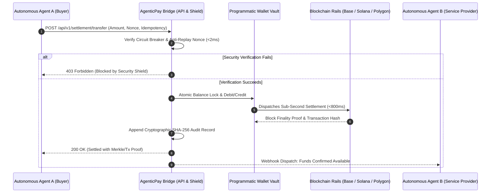

# 🏛️ INSTITUTIONAL TECHNICAL MEMORANDUM
## Architecture, Threat Model & Settlement Protocol for Autonomous Agentic Commerce (A2A) and Turnkey Blockchain Rails

**Document Reference:** `TC-MEMO-2026-A2A-01`  
**Classification:** Open Institutional Architecture Specification  
**Issuing Authority:** ThinkConnect IA Engineering Core  
**Lead Architect & Principal SRE:** Carlos Ferro (`carlos@thinkconnect.com.ar`)  
**Date of Issuance:** October 31, 2026  

---

### 1. Executive Abstract

Legacy financial infrastructure—predicated upon card schemes (Visa/Mastercard), correspondent banking (SWIFT), and automated clearing houses (ACH/Fedwire)—was engineered for human-mediated, batch-cleared commerce. These legacy rails exhibit fatal structural constraints when exposed to the emergent autonomous agent economy:
1. **Excessive Latency:** Batch settlement cycles spanning 24 to 72 hours, exacerbated by weekend and holiday banking freezes.
2. **Prohibitive Cost Baselines:** Intermediary fees ranging from $0.30 fixed + 2.9% variable to $25+ per wire transfer, rendering sub-dollar micro-transactions mathematically unfeasible.
3. **Interactive Human Barriers:** Multi-Factor Authentication (3D Secure, SMS OTP, biometric prompts) inherently designed to obstruct autonomous, non-human actors.

**AgenticPay Bridge** resolves this paradigm mismatch by providing financial technology platforms (Fintechs), neobanks, and autonomous agent runtimes with an ultra-lightweight (<60MB RAM), sub-second (<800ms) settlement gateway operating over high-performance blockchain rails (USDC/USDT on Base, Solana, and Polygon). It bridges traditional RESTful fintech cores with programmatic digital asset accounts, reinforced with hardened, deterministic security controls.

---

### 2. High-Performance Settlement Architecture



#### Key Protocol Characteristics:
* **Settlement Currency:** Institutional Stablecoins (USDC / USDT), pegged 1:1 with the United States Dollar and backed by short-term US Treasury bills and cash equivalents.
* **Execution Latency:** Sub-800ms end-to-end execution. Internal API routing latency is constrained under 15 milliseconds.
* **Atomic State Isolation:** In-memory ledger semantics with atomic balance locks prevent race conditions, double-spending, and inconsistent state during concurrent transfers.

---

### 3. Programmatic Wallet Vault Specification

Fintechs integrating the Bridge are provided with a non-custodial and programmatic sub-account provisioning layer:
* **Zero Private Key Exposure:** Private keys and signing capabilities are decoupled from exposed web endpoints. The vault exposes deterministic API primitives (`create_wallet`, `deposit_funds`, `transfer_funds`) without raw cryptographic keys residing in web application memory.
* **Multi-Asset Balance Partitions:** Each wallet maintains segregated ledger partitions for USDC, USDT, and reference local fíat units.
* **Deterministic Identifier Namespace:** Wallets utilize prefixed hexadecimal identifiers (`wlt_xxxxxxxxxxxx`), facilitating rapid indexing and trace logging across distributed tracing environments (OpenTelemetry/Jaeger).

---

### 4. The 'Black October' Defensive Threat Model

Following the widespread security breaches, model jailbreaks, and automated liquidity drain incidents observed across autonomous agent deployments in late 2026, AgenticPay Bridge embeds an uncompromising, four-layer defensive security perimeter:

| Defense Tier | Mechanism | Implementation Detail | Failure Mode / Penalty |
| :--- | :--- | :--- | :--- |
| **Tier 1: Liquidity Ceiling** | Maximum Transaction Limit | Hard ceiling enforced per single transfer request (Default: $5,000 USD). | Transaction rejected immediately with HTTP 403. |
| **Tier 2: Velocity Breaker** | Trailing 60-Second Volumetric Monitor | Aggregated volume and transaction frequency tracked dynamically in a sliding 60-second window. | Trips global circuit breaker; freezes all financial outflows; alerts sysadmin. |
| **Tier 3: Anti-Replay Fencing** | Monotonic Nonces & Ephemeral IDs | Every settlement call requires a strictly increasing sequence nonce per agent identity. | Replayed payloads (nonce $\le$ last_seen) are rejected in $<1\text{ms}$. |
| **Tier 4: Runtime Hardening** | Ultra-Lean Memory Footprint | Pure Python 3.12 / FastAPI runtime running inside an unprivileged Docker scratch container ($<65\text{MB}$ RAM). | Eliminates Node.js / NPM supply-chain attack surfaces entirely. |

---

### 5. Regulatory Alignment, Tax Compliance & Forensic Auditability

One of the principal barriers preventing institutional fintechs from embracing blockchain settlement is the perceived absence of regulatory traceability. AgenticPay Bridge bridges this gap through dual-layer reconciliation:
1. **Public Blockchain Verifiability:** Every transaction is permanently etched onto a public or permissioned L2/L1 distributed ledger, rendering historical manipulation mathematically impossible.
2. **Off-Chain Cryptographic Audit Trail:** The internal engine generates a SHA-256 fingerprint for every operation:
   $$\text{Hash} = \text{SHA256}(\text{tx\_id} : \text{sender} : \text{receiver} : \text{amount} : \text{asset} : \text{timestamp})$$
3. **Forensic Report Generation:** Native compliance endpoints provide structured data exports compatible with tax authority reconciliation engines (IRS Form 1099-DA standards, ARCA electronic registries, and EU DAC8 reporting).

---

### 6. Deployment Topology & Technical Inquiries

AgenticPay Bridge is distributed as an open-core turnkey container. It requires zero multi-tenant cloud subscriptions and can be deployed on any bare-metal Linux host, dedicated server, or Kubernetes cluster within five minutes:

```bash
docker run -d -p 8088:8088 --name agentic-pay-bridge thinkconnect/agentic-pay-bridge:1.0
```

#### Direct Engineering Inquiries:
For custom core-banking integrations, HSM (Hardware Security Module) key orchestration, or enterprise hardening advisory:
* **Contact:** Carlos Ferro — Principal Infrastructure & DevOps Engineer
* **Email:** `carlos@thinkconnect.com.ar`
* **Architecture Repository:** ThinkConnect IA Institutional Archive
